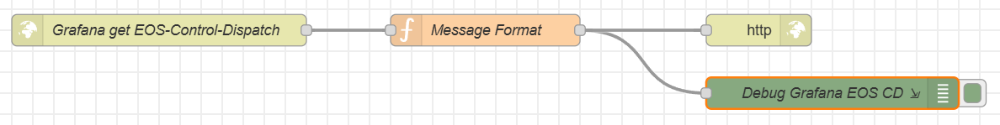
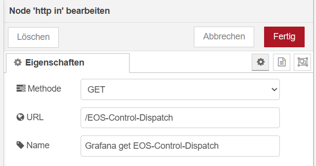
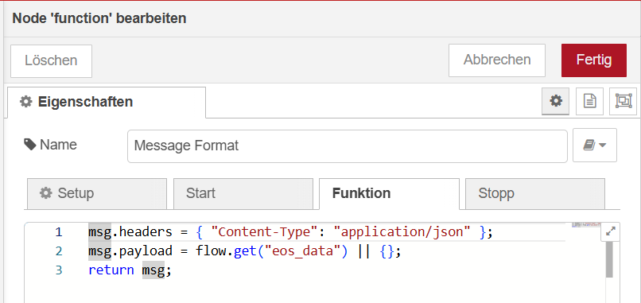
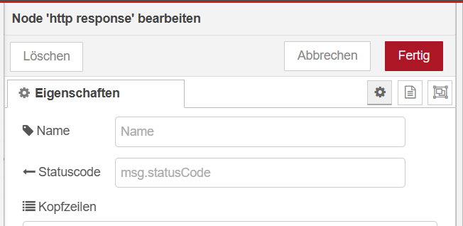

% SPDX-License-Identifier: Apache-2.0
(adapter-nodered-page)=

# Node-RED Adapter

The Node-RED adapter provides a **bidirectional interface** between
**NodeRED** and the **Akkudoktor-EOS (EOS)** energy optimisation system.

It allows EOS to:

* **Provide** control instructions via HTTP-IN Node
* **Receive** measurements and device states via Node-RED
  (The HTTP-IN Node "eos_data_acquisition" is NOT yet functional)

This adapter enables a handover of the EOS control instructions (EV, battery & home appliance)
for the current timeslot via Node-RED to any desired integration,
while keeping EOS **device simulations and optimisation
logic decoupled from other implementations**.

## 1. Exchanging data between EOS and Node-RED

### Basic concept

EOS **receives** e.g. measurements via HTTP-IN by Node-RED before each energy management run.
(The HTTP-IN Node "eos_data_acquisition" is NOT yet functional)

EOS **provides control instructions** via HTTP-IN to Node-RED after each optimisation run.

Typical use cases with Node-RED:

* optimal for heterogeneous systems
* Automations and scripts
* Device or manufacturer integrations
* Debugging and validation

### Configuration steps in EOS

#### 1. Enable and configure the Node-RED adapter

EOS must be configured with access to the Node-RED instance in Config->adapter.

* prerequisite is an already installed and running Node-RED instance
* adapter.nodered.host: 192.168.1.109 (example IP of your Node-RED instance)
* adapter.nodered.port: 1880 (default)
* adapter.provider: ["NodeRED"]

#### 2. Run energy optimisation

Before the run, EOS receives:

* EOS receives measurement values via HTTP-IN "eos_data_acquisition" before optimisation.
  (The HTTP-IN Node "eos_data_acquisition" is NOT yet functional)

After the run, EOS provides:

* The device instruction and solution entities for the current time slot via HTTP-IN "Control Dispatch".

### Configuration steps in NodeRED

#### 1. Create Node-RED flow with nodes for processing

* EOS Control Disptach

## 2. Data obtained *from EOS*

### 2.1 Device instruction (Control Dispatch)

After each energy optimisation run, EOS produces **device instructions** for the
controlled resources.

E.g.:
`{"battery1_op_mode":"SELF_CONSUMPTION","battery1_op_factor":1,"ev11_op_mode":"IDLE","ev11_op_factor":1,"homeappliance1_op_mode":"RUN","homeappliance1_op_factor":1}`

* The **entity state** represents the device's selected **operation mode**.
* **Entity attributes** provide additional parameters for the operation mode, such as:

  * `operation_mode_factor`
  * Power or rate limits
  * Mode-specific control parameters

## 3. Data retrieved by EOS via Node-RED

"Under construction".

## 4. Further processing of EOS data

Once published, EOS data can be used in any needed scenario:

* Used as triggers or conditions in automations
* Mapped to device-specific services or integrations
* Visualised in dashboards
* Compared with measured values for monitoring and validation

EOS does **not** directly control devices.
It provides **structured optimisation results**, while your tool of choice remains
responsible for executing the actual control actions.

## 5. Calling the planner from an external Node-RED schedule

An existing Node-RED scheduler can call `POST /v1/optimize` with device SoC and
forecast overrides. Hardware settings and the desired charging target remain in EOS
configuration. See the [upgrade guide](../upgrade-genetic.md) for the request contract.

### Reuse the latest available EV SoC

Some vehicle integrations store a new database row only when the battery percentage
changes. A parked vehicle can therefore have an older value-change timestamp even
when the database is being read regularly. A fixed 15-minute age limit on that row
can prevent both EV and household planning indefinitely.

Pass the latest available valid EV percentage explicitly in the request's `soc` map
when that is the intended source policy. EOS accepts explicit SoC without requiring
a separate fresh measurement. Keep the database's original timestamp for diagnostics;
rereading the same row does not make it a newly observed measurement. Validate the
value and database-read availability, and apply any stationary-battery freshness
policy independently of this EV value-change timestamp.

### Preserve the charging target when deploying a flow

Store the desired EV charging target in Node-RED flow or node context using
`flow.set()` or `context.set()`, and restore it when the request function initializes.
A property assigned directly to a Function node's `context` wrapper is not stored
through the context API and can be lost when that node is redeployed. Choose a
persistent context store if values must also survive a Node-RED process restart.
Reload the saved target instead of silently defaulting an active order to zero.

With `max_soc_percentage = 100`, a target of `min_soc_percentage = 100` is valid.
Remove an obsolete client-side restriction to values below 100 rather than lowering
the requested target before sending it to EOS.

### Recover missing forecasts after an EOS restart

Prediction retrieval can fail or return no data while EOS is restarting or a provider
is unavailable. An external scheduler that waits for complete raw price coverage
should route both unsuccessful HTTP reads and empty successful reads through its
existing prediction-recovery path. That path calls `POST /v1/prediction/update`, waits
for completion, then reloads the forecast series and checks coverage again.

Rate-limit recovery attempts, for example to at most once every five minutes, and
avoid starting a second run while optimization is busy. A successful update HTTP
response alone does not establish complete forecasts; providers can still report
failures in the EOS log. Only resume planning after the required series cover the
control period. Preserve the site's interval, time zone and actual source timestamps
when checking raw prices, including daylight-saving transition days.

Prediction recovery must not send device commands or change operator permissions.
Keep existing handling for failed or stale plans until a new successful plan arrives.

### Summary

* **EOS** focuses on **forecasting, simulation, and optimisation**
* **Node-RED** can focus on **moving, processing, integration and execution**

The Node-RED adapter provides a structured interface between EOS and a heterogeneous environment,
allowing flexible integration without coupling EOS to device specifics.
