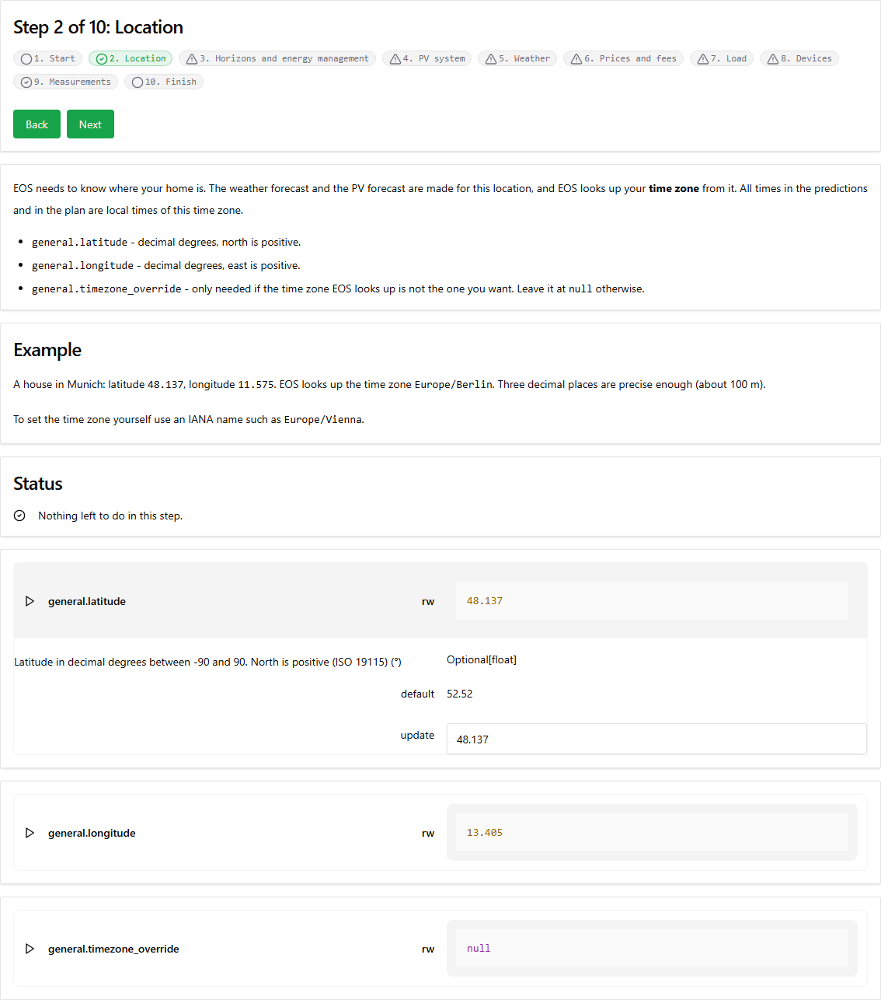

% SPDX-License-Identifier: Apache-2.0
(setup-page)=

# First Setup with the Setup Assistant

A freshly installed EOS runs, but it does not know your home yet: where it is, what your PV system
looks like, what electricity costs and which devices it may plan for. The **setup assistant** of
EOSdash takes you through these settings step by step.

Open EOSdash - by default at [http://localhost:8504](http://localhost:8504), or with **Open Web UI**
in the Home Assistant add-on - and select **Setup** in the menu.

## How the Assistant Works

Each step consists of

- an **explanation** of the settings of the step,
- an **example**,
- a **status** that tells you what is still to do in the step,
- the **configuration cards** of the settings of the step.

The configuration cards are the same as on the **Config** page of EOSdash:

- Click a card to open it. It shows the description, the type and the default of the setting.
- Type the new value into the **update** field and press Enter, or choose a value and press **Set**.
  EOS checks the value. If EOS rejects it, the card shows why.

The list at the top shows all steps. A check mark means EOS has what it needs from the step, a
warning sign means something is left to do. Click a step to go there directly, or use **Back** and
**Next**.

The assistant keeps no state of its own. It reads what is done and what is missing from the EOS
configuration. You can therefore leave it at any time, change settings on the **Config** page or by
the [server API](#server-api-page), and come back later.

:::{admonition} Note
:class: note
A changed setting is used by EOS right away. By default EOS also saves it to the EOS configuration
file on its own (`general.config_save_mode` is `AUTOMATIC`). If you set the save mode to `MANUAL`,
save the configuration in the last step of the assistant. See the
[configuration guideline](#configuration-page).
:::

## The Steps

1. **Start** explains the assistant.
2. **Location**: latitude and longitude of your home. EOS looks up the time zone from them.
3. **Horizons and energy management**: how far EOS predicts and plans ahead, whether the energy
   management runs and how often. See [automatic optimization](optimauto.md).
4. **PV system**: the PV forecast provider and what it needs, e.g. the planes of your PV system. See
   [predictions](#prediction-page).
5. **Weather**: the weather forecast provider.
6. **Prices and fees**: the electricity price, the fees added to it and the feed-in tariff.
7. **Load**: the forecast of your consumption.
8. **Devices**: batteries, inverters, electric vehicles and home appliances.
9. **Measurements**: how the current state of charge and the meter readings get to EOS. See
   [measurements](#measurement-page), the [Home Assistant adapter](#adapter-homeassistant-page) and
   the [Node-RED adapter](#adapter-nodered-page).
10. **Finish** shows the status of all steps and a button to save the configuration.

You do not need every step. Skip the **PV system** step if you have no PV system, and set up only
the devices you have.

## Things to Know

- **The energy management is off by default.** Outside of Home Assistant `ems.mode` is `DISABLED`
  and EOS neither predicts nor optimizes on its own. Set it to `OPTIMIZATION` in the step **Horizons
  and energy management**. `PREDICTION` only updates the predictions, which is useful while you are
  still setting up the forecasts.
- **Market prices come without fees.** The market price providers deliver the raw price. Add your
  fees per kWh and the VAT with the electricity fee provider in the step **Prices and fees**.
- **The state of charge is a factor.** The measurement `<device_id>-soc-factor` of a battery or an
  electric vehicle goes from `0.0` (empty) to `1.0` (full), not from 0 to 100.
- **The state of charge must be fresh.** The GENETIC optimization does not use a state of charge
  older than `optimization.genetic.measurement_max_age_seconds` (300 seconds by default) and then
  plans with an empty battery.

## After the Setup

Look at the **Prediction** page of EOSdash to check the forecasts and at the **Plan** page for the
result of the optimization. All settings, including those the assistant does not show, are on the
**Config** page and described in the [configuration guideline](#configuration-page).
